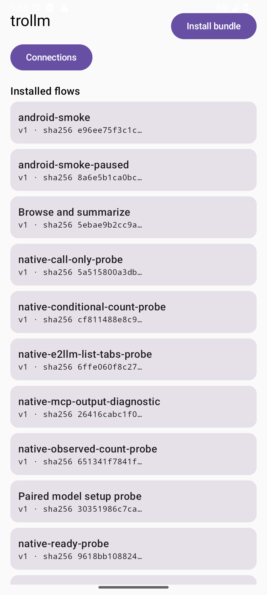
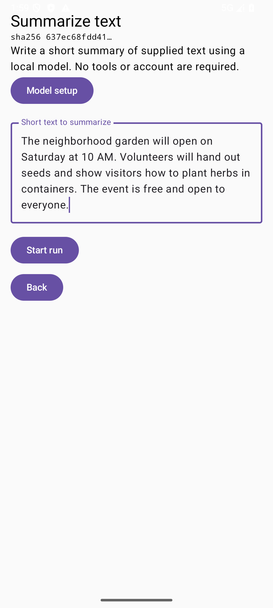
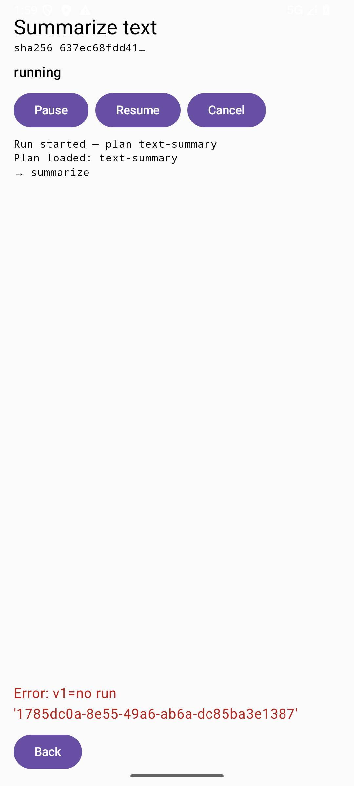
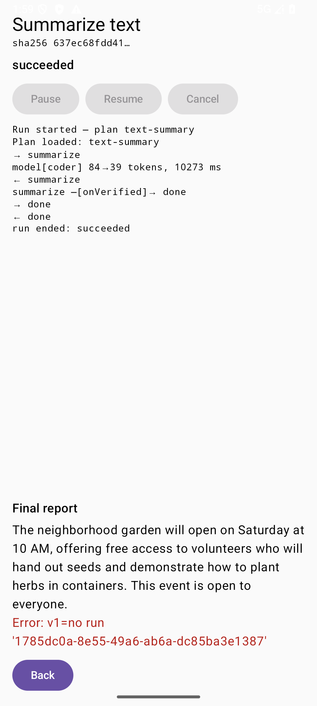
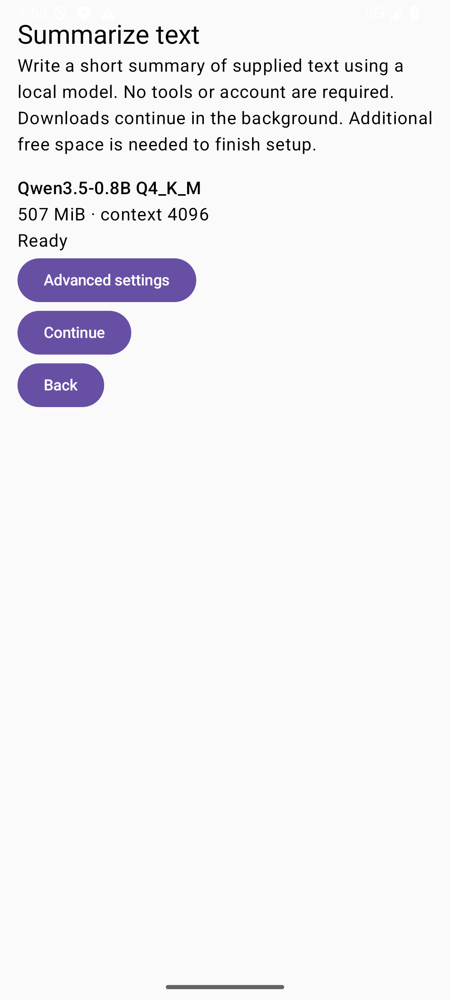
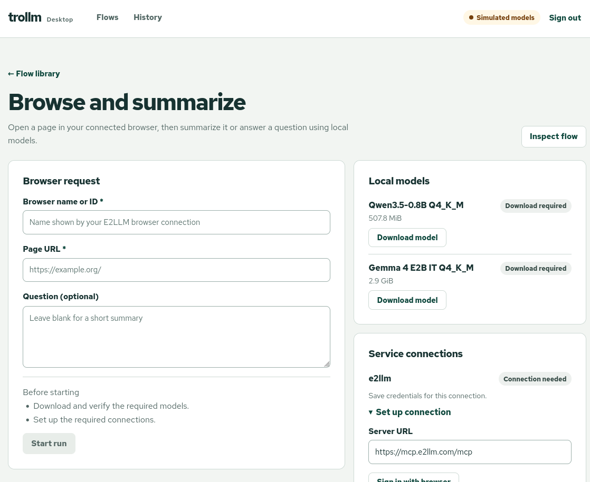
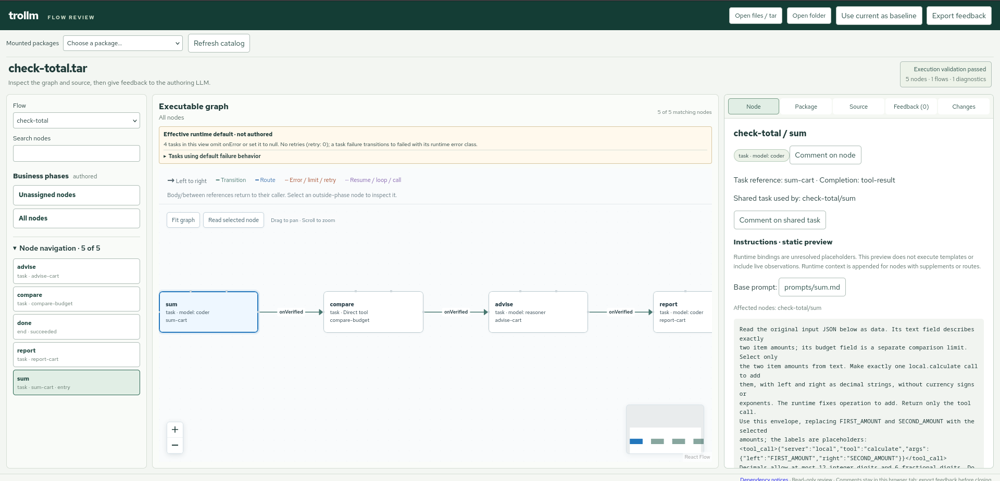

# trollm: pronounced “tro-le-lem”

trollm lets you try a practical task with small language models running on your
phone. Install the Android app and pick a **flow**, a sequence of steps for a
task. Give **Check a total** two prices and a budget. It uses the calculator
to add the prices and compare the sum with your budget. The [Linux desktop preview](apps/desktop/README.md)
runs flows with the same runtime. You can use the included flows, write your
own or adapt the open-source runtime for another app.

## Run a flow on Android

<p align="center">
  <a href="docs/screenshots/android/01-flow-library.png"></a>
  <a href="docs/screenshots/android/02-prepare-flow.png"></a>
  <a href="docs/screenshots/android/03-run-progress.png"></a>
  <a href="docs/screenshots/android/04-completed-report.png"></a>
  <a href="docs/screenshots/android/05-model-preparation.png"></a>
</p>

These screenshots show a text-summary run in an earlier Android interface.

1. **Install the app.** On Android 13 or later, download `app-release.apk` from
   an Android release, open it, and follow Android's prompts.
   [Latest release](https://github.com/e2llm/trollm/releases/latest) · [Installation and verification](docs/INSTALL-ANDROID.md)
2. **Choose or add a flow.** Start with **Summarize text** or **Check a total**
   in the library. Both run locally after their models are downloaded. To add
   a flow, save its `.tar` file on your phone, then tap **Manage flows → Import
   flow file** and select it. [Download the Amazon v342 bundle (.tar)](https://raw.githubusercontent.com/e2llm/trollm/main/examples/run-342/amazon-cart-v342.tar)
3. **Connect a browser if the flow uses E2LLM.** Open the flow's connection setup
   in trollm and choose **Sign in with browser**. In the browser you want the flow
   to use, install the E2LLM extension and connect it with the **same E2LLM account**.
   That browser can be on another computer. [E2LLM browser extension setup](https://e2llm.com/start/)
4. **Run it.** Enter the flow's input and download the required models shown on
   its setup screen. Once they're ready, tap **Start run**, follow progress, and
   read the report when the run finishes.

For the Amazon example, use the connected browser's name or ID, keep only the
intended Amazon tab open in that browser, and follow the example's input format.
The flow updates the cart and stops before checkout. The recorded runs used an
earlier APK and specific model files. [Amazon v342 instructions and run evidence](examples/run-342/README.md)

## Run a flow on Linux (preview)



The Linux x86-64 preview runs flows with local CPU models. Start the container,
open the app in your browser and choose a flow. You can return to its report
from **History**. [Install and run the Linux preview](apps/desktop/README.md#install-and-start)

## Inspect a flow on a desktop



Pull the public Linux/amd64 viewer image with Docker.

```sh
docker pull --platform linux/amd64 ghcr.io/e2llm/trollm-flow-review:latest
```

Start the container using the flags in the deployment guide.
[Run the viewer with Docker](apps/flow-review/deploy/README.md#start-the-viewer-with-docker)

Open `http://127.0.0.1:8080` on the host running the viewer. Choose **Open files /
tar** to load the same flow bundle, or **Open folder** to load flow source.
The viewer displays the flow's steps, prompts, and tool permissions. The Android
app and Linux desktop preview execute flows and run local models.

## Learn, author and contribute

1. [Learn trollm](docs/LEARN-TROLLM.md) gives a complete product and system picture.
2. [Anatomy of a flow](docs/ANATOMY-OF-A-FLOW.md) follows a smaller, tool-free source
   example through its plan, registry, prompt and existing scripted test.
3. [Authoring a flow](docs/FLOW-AUTHORING.md) starts from intent and task contracts,
   then connects source construction, model evaluation and human review. Its wider
   proposed authoring pack is identified separately from today's method.

The [documentation tracks](docs/README.md) give ordered prerequisites, cumulative
reading costs and stopping outcomes. Use the reference map there for specific
runtime, Android, reliability or security work. Before contributing, read
[AGENTS.md](AGENTS.md) and [Contributing](CONTRIBUTING.md) for the affected layer.

## Current evidence and limits

Two selected runs of the Amazon cart flow used local Qwen 0.8B and 2B models
on a Samsung A04e and an S21. Both completed the supplied mission. Their
largest recorded model inputs were 1,237 and 1,253 tokens, even though the
runs lasted about 4 hours 20 minutes and 1 hour 41 minutes respectively.
You can inspect the inputs, bundle, pinned models, results and sanitized logs
to see how the work was split into small steps. These observations apply to
the two recorded runs. [Explore the v342 examples](examples/run-342/README.md)

For the checks performed on a particular Android build, see its release notes.
[GitHub Releases](https://github.com/e2llm/trollm/releases)

## Repository and contribution boundaries

`crates/` contains the executor, model interface, MCP gateway and UniFFI bridge.
`apps/android/` contains the app. `flows/` and `schemas/` contain current source
references; scripted examples are development fixtures, and procurement is an
incomplete design sketch. The separate [flow review companion](apps/flow-review/README.md)
inspects packages and collects feedback; it does not execute flows.

Trollm remains usable with direct authors and other producers. The optional
[Moray source connector](docs/MORAY-SOURCE-CONNECTOR.md) does not make a Moray
account or central controller a prerequisite for unrelated flows. Each native
contract and its current acceptance scope still applies.

For issues and pull requests, see [Contributing](CONTRIBUTING.md). See [Versioning](docs/VERSIONING.md),
[Security](SECURITY.md) and [Third-party notices](THIRD_PARTY_NOTICES.md) for their
respective release and reporting boundaries.
