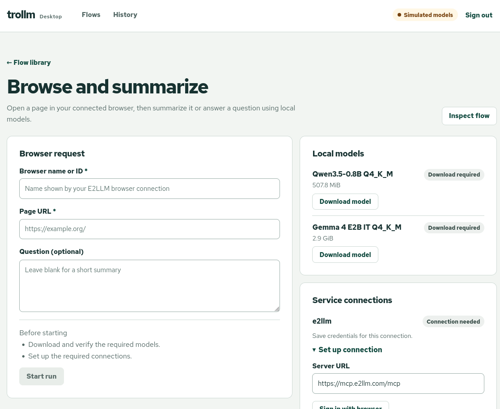

# Linux desktop preview



This application runs trollm flows on Linux x86-64 using local CPU inference.
Its browser interface installs flow bundles, prepares pinned models and
connections, starts runs, and shows progress, reports and saved history.
The executor, tool policies, mutation journal and model implementation are shared
with the Android app.

This is an experimental preview. Build and acceptance results apply to the exact
image that was checked. macOS, Windows, Linux ARM64 and GPU builds are outside
the preview's scope.

## Install and start

Use Docker on Linux x86-64 to run an image from the `:preview` channel.
If the tag is unavailable, [build and start from source](#build-from-source).
If the [flow review companion](../flow-review/deploy/README.md) is using port
8080 on this machine, stop it first.

```sh
docker pull --platform linux/amd64 ghcr.io/e2llm/trollm-desktop:preview &&
docker run --detach --rm --name trollm-desktop --platform linux/amd64 \
  --publish 127.0.0.1:8080:8080 --read-only --user 10001:10001 \
  --cap-drop ALL --security-opt no-new-privileges=true \
  --tmpfs /tmp:rw,noexec,nosuid,size=64m \
  --cpus 2 --memory 8g --pids-limit 256 --stop-timeout 30 \
  --mount type=volume,source=trollm-desktop-data,target=/data \
  ghcr.io/e2llm/trollm-desktop:preview
```

Open **http://127.0.0.1:8080** on the machine running Docker and create a
desktop passphrase. It protects saved connection credentials and unlocks the
app again after a restart. Use your E2LLM account separately for browser flows
that need it.

Docker stores installed flows, models, credentials and run history in the
named volume `trollm-desktop-data`. Model weights are downloaded separately.
The preparation screen shows their sizes. Memory needs depend on the models
and context settings, within the 8 GiB container limit above.

## Run a flow

1. Choose **Summarize text** for a local first run. Download its required model
   and wait for verification to finish.
2. Enter the flow's input and choose **Start run**. Read its report when it
   finishes. **History** reopens the saved result.
3. In the library, choose **Import flow** to add an ordinary, uncompressed
   `.tar` flow bundle. Inspect its steps, prompts and tool permissions before
   running it. The manifest checks file integrity; it does not authenticate
   the author.
4. If a flow uses E2LLM, sign in from its connection preparation, then connect
   the E2LLM extension in the intended browser with the same account. That browser
   can be on another computer. [Extension setup](https://e2llm.com/start/)

Android managed-source installs and native collection profiles are outside the
preview's scope. Existing runs associated with a managed source or managed
installation cannot be opened or resumed on desktop.

The browser interface is for one local user and one active run. It does not
provide a multi-user service or remote administration interface. Use the
configured loopback origin; the API rejects other browser origins and requires
an authenticated local session.

## Downloads, credentials and recovery

Model downloads retain partial files for explicit continuation. A model becomes
ready only after its declared size and full SHA-256 have been checked. Existing
files are checked again after a host restart. Do not edit model files while a
run is preparing or using them.

Connections can use an endpoint-bound manual bearer token or supported browser
OAuth. Browser OAuth uses public Web PKI, same-origin authorization-server
metadata, public-client registration and PKCE. The provider must accept the
desktop loopback redirect. Private CA installation and separate third-party
authorization issuers are not supported by this preview.

Credentials are encrypted in the local vault. API session tokens stay in the
browser's session storage. Neither belongs in a flow bundle or image. A run
retains its selected endpoint and credential identity; replacing a connection
does not switch that run to another account. A running worker can retain its
already-bound manual token. Use the run's controls to stop work.

Closing the browser does not stop the host. Stopping the container interrupts
running work. Reopening trollm does not automatically resume it: use History
and explicit **Resume** where offered. A failed or interrupted mutation may
already have taken effect, and recovery can refuse to replay it. If Start loses
its response, check History before starting another run.

Losing the desktop passphrase prevents decrypting its saved connection
credentials. Exported diagnostics can contain the flow's inputs and tool results.

## Stop, update or pin the image

Finish or stop an active run in the app before stopping the container.

```sh
docker stop trollm-desktop
```

The container is removed on exit. Docker retains the named volume
`trollm-desktop-data`. Run the [install and start commands](#install-and-start)
again to pull the current preview and recreate the container with the same
volume. Pulling an image does not replace a running container. Keep the volume
to preserve your installed flows, models, credentials and history.

The `:preview` tag advances when a new preview build is published. For a
repeatable install, use a published full commit tag or a digest reference of
the form `ghcr.io/e2llm/trollm-desktop@sha256:<digest>` in both commands.
[Image tags and digests](https://github.com/e2llm/trollm/pkgs/container/trollm-desktop)

## Build from source

Run these commands from the repository root with Docker and Compose installed.

```sh
docker build --platform linux/amd64 \
  --file apps/desktop/Containerfile \
  --tag localhost/trollm-desktop:local .
docker compose --file apps/desktop/compose.yaml up --detach
```

The checked-in `Containerfile.dockerignore` limits Docker's build context.
Podman users can build the same image with an explicit ignore file:

```sh
podman build --platform linux/amd64 \
  --ignorefile apps/desktop/.containerignore \
  --file apps/desktop/Containerfile \
  --tag localhost/trollm-desktop:local .
```

Open **http://127.0.0.1:8080** on the Docker host. Compose creates its own
project-prefixed volume (usually `desktop_trollm-data`) for the `trollm-data`
entry in `compose.yaml`. Standalone Docker uses `trollm-desktop-data`. Each
setup opens the data in its own volume.

From the repository root, stop the source-built container with this command.
Keep the Compose project name and omit `--volumes` to reuse its data on the
next start.

```sh
docker compose --file apps/desktop/compose.yaml down
```

## Container settings

| Variable | Purpose | Container default |
| --- | --- | --- |
| `TROLLM_DESKTOP_BIND` | Listener inside the container | `0.0.0.0:8080` |
| `TROLLM_DESKTOP_ORIGIN` | Exact browser origin and OAuth callback base | `http://127.0.0.1:8080` |
| `TROLLM_DESKTOP_ORIGIN_ALIAS` | Optional explicitly allowed loopback alias | unset |
| `TROLLM_DESKTOP_DATA` | Private persistent directory, owner-only permissions | `/data` |
| `TROLLM_DESKTOP_WEB` | Built browser assets | `/app/web` |
| `TROLLM_DESKTOP_STARTERS` | Checked starter bundles | `/app/starters` |

The health command is `/app/trollm-desktop --healthcheck`. Dependency notices are
under `/app/notices`; browser notices are also included with the static assets.
The default build uses native llama.cpp. The explicitly selected `stub` feature
is for development tests and is labelled **Simulated models** in the interface.

## Development checks

Use the pinned Rust toolchain and the Node version required by
`web/package.json`. Run these source and stub checks from the repository root.
They require no model files.

```sh
cargo fmt -p trollm-desktop -- --check
CARGO_BUILD_JOBS=2 cargo clippy --locked -p trollm-desktop \
  --no-default-features --features stub --all-targets -- -D warnings
CARGO_BUILD_JOBS=2 cargo test --locked -p trollm-desktop \
  --no-default-features --features stub
npm --prefix apps/desktop/web ci
npm --prefix apps/desktop/web run typecheck
npm --prefix apps/desktop/web run build
```

Install Playwright Chromium, or set `PLAYWRIGHT_CHROMIUM_EXECUTABLE_PATH` to a
local Chromium executable. The default browser suite starts a local Vite
server and exercises the interface with mocked API responses. The actual-host
test runs only when a desktop URL is supplied.

```sh
npm --prefix apps/desktop/web exec -- playwright install chromium
npm --prefix apps/desktop/web run test:browser
```

To exercise the running host, point `host.spec.ts` at a disposable desktop
instance with the `stub` backend and built browser assets. The test imports a
flow and saves a run. To use a native host, also set
`TROLLM_DESKTOP_BROWSER_REAL_MODE=llama` and prepare the **Summarize text** model
before running the test.

```sh
TROLLM_DESKTOP_BROWSER_URL=http://127.0.0.1:18080 \
  npm --prefix apps/desktop/web run test:browser -- host.spec.ts
```

`deploy/smoke.py` checks an actual endpoint and a direct-call fixture. Its optional
`--real-model` mode downloads the pinned **Summarize text** model and checks a
native report. Report scripted, native-model and authenticated browser results
with the exact build tested.
