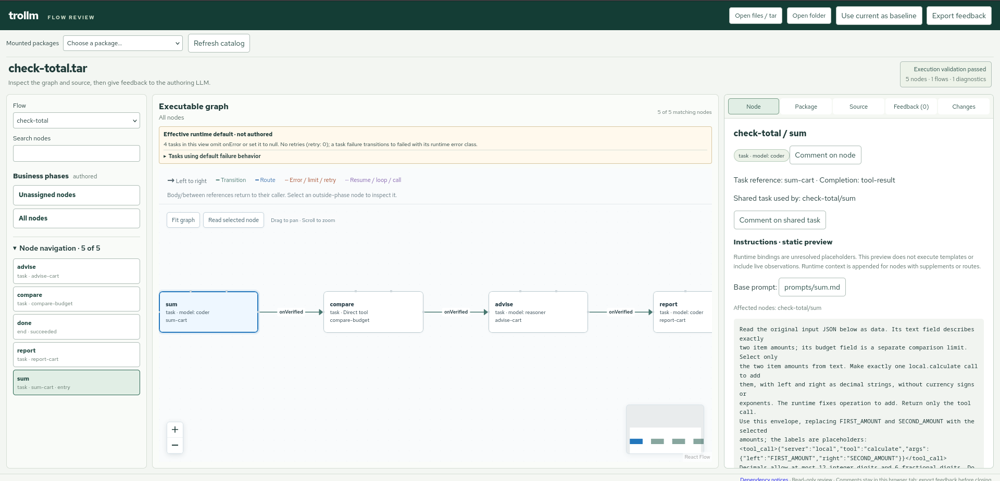

# trollm flow review



A self-hostable browser companion for reviewing LLM-authored flow packages.
Open a package, read its purpose and business phases, inspect the graph and
instructions, comment, and export feedback for the authoring LLM. Load a revised
package to compare changes. The application does not execute or edit flows.

The UI targets desktop monitors. It uses the full window: navigation on the left,
a graph canvas in the center and a separately scrolling inspector on the right.
Open the phase containing the entry step, or choose another phase or All nodes.
The default view keeps labels readable; use **Fit graph** for the whole path,
**Read selected node** to return to readable detail, and the minimap or drag to
move around. Arrows show branches and recovery; outside-phase cards navigate to
their actual source nodes. The inspector has Node, Package, Source, Feedback and
Changes tabs. A window at least 1180 pixels wide is expected.

The [design and implementation record](../../docs/flow-review/README.md) explains
the contracts and exact validation status. This component is separate from the
Android app. Its server reuses trollm's Rust readers and validators; it needs no
models, Android SDK, MCP accounts or LLM API key.

## Get the public image

The [Docker quick start](deploy/README.md#start-the-viewer-with-docker) pulls
and runs the public **Linux/amd64** image without a registry login.
Open `http://127.0.0.1:8080` on that host and choose **Open files / tar** to load
an uncompressed flow bundle or **Open folder** to load its source directory.
To browse mounted packages, use the
[Podman launcher](deploy/README.md#start-the-viewer-with-podman) with its own
image store and package directory.

## Build locally with Podman

Running the pod requires Podman 5.0 or newer for its memory-backed transient
volume. Run the build from the repository root.

```sh
podman build --format docker --ignorefile apps/flow-review/.containerignore \
  -f apps/flow-review/Containerfile \
  -t localhost/trollm-flow-review:dev .
```

The mapped host directory contains one subdirectory per source package, or
individual uncompressed trollm `.tar` bundles. The checked-in `flows/starters`
directory supplies several source packages, including Check a total with authored
business descriptions. A source directory contains its plan, task registry,
prompts, subflows, optional setup and optional `flow-review.json`.

With Python 3 and PyYAML available, launch the pod:

```sh
python3 apps/flow-review/deploy/launch.py \
  --image localhost/trollm-flow-review:dev \
  --packages "$PWD/flows/starters" --port 8080
```

Open `http://127.0.0.1:8080`. The launcher maps the directory read-only and waits
for health. `--print` emits the configured pod specification without starting it.
Alternatively adapt [deploy/pod.yaml](deploy/pod.yaml) and use `podman kube play`.
See [deployment instructions](deploy/README.md) for rootless operation, storage,
access control, replacement, shutdown and the actual container smoke command.

The default host bind is loopback. For a remote browser, configure the bind and
your existing TLS/access-control proxy. The application has no built-in accounts
or shared database. Package content goes to your own host; normal viewing does
not send it to a public renderer or model provider.

## Review loop

1. Open a mounted package, upload an uncompressed `.tar` bundle, or select source
   files/a folder. Preserve relative prompt/subflow paths. If several roots or
   registries exist, choose the intended pair.
2. Use the phase navigation and graph. Unassigned nodes remain available. Inspect
   transitions, tool grants, limits, recovery and prompts where behavior matters.
   Details open on the right without moving the canvas. Package information and
   validation/root selection live in the Package tab. A valid package does not
   establish accurate model output.
3. Attach comments to the relevant phase, node, task, file or field in Feedback. Export
   feedback before closing/reloading the page. Comments retain their original
   revision and target; reloading does not resolve them automatically.
4. Give that Markdown to the authoring LLM with the package and
   [authoring instructions](../../docs/FLOW-AUTHORING.md). It updates executable
   sources and descriptions and runs applicable checks.
5. Keep the earlier inspection as a baseline and load the revision. Review
   changed routes, tool permissions, limits, setup and prompt text. Renames appear
   as removal/addition; prompt comparisons do not claim equivalent meaning.

Uploaded imports are staged in request-private transient directories and removed
after inspection, including errors. The mapped directory is never rewritten.
Snapshots and comments remain in browser page state; feedback export is the
durable handoff. Runtime credentials and model weights are not inputs.

Server imports are bounded to 64 MiB encoded requests/aggregate text, 32 MiB per
member, 1,024 files or directory entries, 256 flows and 10,000 nodes. Browser file
selection uses a conservative 32 MiB text total before JSON encoding. Nested
paths and flow references are bounded. Two inspections run concurrently; the
60-second HTTP timeout does not interrupt an already running bounded validation
worker, whose staging is removed when it finishes. Validation covers the selected
entry and referenced subflows; unused flows remain visible with warnings.

## Business descriptions for authoring LLMs

Supply optional `flow-review.json` alongside sources. Follow the
[presentation contract](../../docs/flow-review/INTERFACE.md) and
[JSON schema](flow-review.schema.json). The
[Check a total example](../../flows/starters/check-total/flow-review.json) groups
real node IDs into arithmetic, assessment and reporting phases.

Descriptions explain purpose and consequences. Actual tools, routes and limits
come from executable files. Invalid phase references produce diagnostics;
omitted or ungrouped nodes remain discoverable. This metadata adds no fields to
the execution-plan schema. If included in an installable bundle, list its exact
hash in the existing manifest.

## Development and checks

Use the pinned Rust toolchain and Node version required by `web/package.json`.
Check RAM/disk first; no native model build is needed. From the repository root:

```sh
cargo test --locked -p trollm-flow-review
cargo clippy --locked -p trollm-flow-review --all-targets -- -D warnings
```

From `apps/flow-review/web`:

```sh
npm ci
npm run audit:prebuild
npm run check
npm run lint
npm test
npm run build
npm run audit:final
npm run test:browser
```

Browser tests require Playwright Chromium or the executable override in
`playwright.config.ts`. Unit tests, browser fixtures, real-server HTTP checks and
actual Podman smoke establish different parts of delivery; none is a phone or
model acceptance test.

The Rust inspection server targets the Linux environment provided by the pod.
Other desktop hosts can use that container environment for server development;
the browser itself is independent of the server's host OS.

After building browser assets, run from the repository root:

```sh
FLOW_REVIEW_PACKAGES="$PWD/flows/starters" \
FLOW_REVIEW_STATIC="$PWD/apps/flow-review/web/dist" \
FLOW_REVIEW_BIND=127.0.0.1:8080 \
cargo run --locked -p trollm-flow-review
```

`FLOW_REVIEW_TEMP` defaults to `/tmp/trollm-flow-review`. The service exposes
`/healthz` and the inspection endpoints in the
[interface contract](../../docs/flow-review/INTERFACE.md).
`FLOW_REVIEW_BIND` accepts numeric IPv4/IPv6 socket addresses, such as
`127.0.0.1:8080` or `[::]:8080`, and `localhost:8080` as an explicit IPv4 loopback
alias. Other hostnames are rejected rather than resolved through DNS.

The Containerfile runs `audit:prebuild`, builds the browser assets and then runs
`audit:final` in the same build stage. Keep the original receipt and generated
inventory together. Both gates require zero findings in the full and production
npm audits. The image check verifies the original receipt, bundled modules and
asset hashes. [Viewer audit policy](web/scripts/audit-policy.json)

The container uses `trollm-flow-review --healthcheck` to probe its own endpoint.
This command succeeds only for HTTP 200 with `status: ok`, has a three-second
deadline and bounded response size, and does not initialize imports or models.
The image uses distroless Debian 13 `base-nossl` with libgcc and its
package/license metadata. The server uses Rustls for TLS and runs its health
probe without a shell or curl.

## Code map

- `server/`: catalog/import boundaries, canonical validation, presentation, HTTP.
- `web/`: overview, graph, inspector, feedback and comparison; own npm lockfile.
- `deploy/`: portable pod specification, launcher and actual image smoke.
- `Containerfile`: multi-stage build using the repository root as its context.
- `flow-review.schema.json`: optional authored presentation contract.

The server is a Rust workspace member that reuses the runtime's plan and
registry contracts for inspection. It runs independently of the Android app
and the executor.

Task details retain `toolArguments.modelFields`, typed binding paths and artifact
`view` masks when inspecting current packages. The generation panel explains that
a task deadline is also capped by remaining run time. The companion validates and
displays these declarations; it does not execute discovery, materialize artifact
views or predict whether a model will choose the correct arguments.
