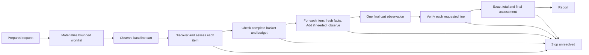

# Generalizing the Amazon demonstrator

Status: **source implemented; host validation passed**, 2026-10-25.
The current source is flow105 / `0.1.0-rc.8` / Android code43. Generic
capabilities and the count-independent package are implemented; CI/security
gates and the native APK are pending. The comparison baseline is flow104 /
Android code42 at `239e7e6`. See [the checkpoint](IMPLEMENTATION.md#current-implementation-checkpoint).
Phone acceptance is separate.

The maintainer clarified the scope: this is a **technological demonstrator** of
trollm executing complex authored procedures, not a complete shopping product.
Assume the input is already prepared usefully for the first step. Input forms,
general natural-language request normalization and consumer onboarding are out
of scope. The same mechanisms should support other procedures such as ticket
triage or hotel comparison without teaching the executor their business rules.

## Target

One package handles a bounded list of distinct requested products. Two items
are an acceptance input, not a graph shape. Changing products, quantities,
budget, order or supported item count must not require regenerating YAML,
changing prompts or rebuilding the package. The initial list bound is
eight items; it is a resource guard, not a claim that eight-item phone runs
already fit the acceptance deadline.

The three iterations are ordinary `foreach` passes. Per-item model tasks receive
the same stable instructions and the current original request. The root handles
cross-item concerns. No model-generated JSON worklist, prose routing words,
expression language, Amazon executor branch or automatically repeated Add is
introduced.

## Why generalization may help

The flow104 baseline often supplied the whole mission and required a model to
recover which product FIRST or SECOND meant. The item-local procedure removes that repeated
selection problem and makes fixes apply equally to every item. Keeping the
original request also prevents a shortened search phrase from silently losing
constraints. Authored generic prompts remain necessary; product facts and
ordinal-specific procedure are the parts to remove.

This is a testable hypothesis, not a performance result. Shared YAML alone does
not remove model calls or prefill. The plan explicitly measures executed calls,
input tokens, model phases, tool work and observer/storage overhead. It retains
fresh observation and uncertain-write boundaries even when they cost calls.

## Reading and implementation order

1. [DESIGN.md](DESIGN.md): procedure, data handoffs, implemented capability
   changes, existing limitations and safe stopping behavior.
2. [PERFORMANCE.md](PERFORMANCE.md): verified size/timing instrumentation,
   repeated scans, measurement boundaries and implemented bounded live observation.
3. [IMPLEMENTATION.md](IMPLEMENTATION.md): bounded work packages, dependency
   order, checks, effort ranges and completion conditions.

Delivery was staged through a host composition slice, generic capabilities and
the Amazon package. Generic source is synchronized to main separately; shopping
procedure stays in its development branch. Host unit/integration, lint, schema/bundle and portable checks pass;
CI/native APK validation is the remaining delivery gate. The phone test owner performs later physical
acceptance. Long CI jobs run without polling loops. Flow104 remains pinned in
history for comparison.
